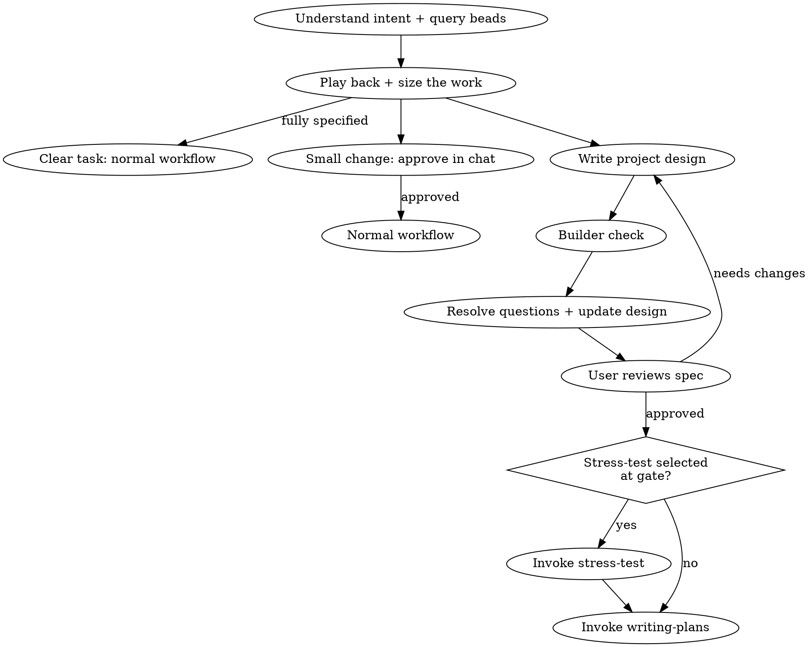

# Brainstorming

You are very good at building. You build what you believe your human
partner wants, and that belief is usually thinner than it feels. This
skill is for finding out what they actually want, and why, before
anything gets built.

People often haven't finished working out what they want. Good questions
help them think it through. When you understand the why, you make the
hundred decisions they never mention the way they would have made them.

**Production-Grade Doctrine** applies with full force here — trade-offs are *first chosen* in brainstorming: you MUST NOT simplify a design by quietly cutting a required behavior; surface every material trade-off and let the user decide. Never weaken, bypass, or remove a security control — a security regression is never acceptable.

## First: What Do You Actually Know?

Before you reply, ask yourself: what do I know about what they want, and
why?

- **Everything that matters is in the request** ("make the icon cornflower
  blue"). This is a quick, clear task. Do it, and say what you did.
- **Something non-trivial is missing.** Start the conversation.

## Your First Message

Your first message is two things, in this order:

1. One line letting them know that if they'd rather skip the questions and
   have you just start, they can say so. If they take you up on it, this
   skill is done: state any significant how-it-gets-made choice
   (platform, language, medium) in one plain line, then do what they
   asked through the normal workflow.
2. One open question that gets them describing. Ask about a real moment
   or a concrete picture: "What's the moment you find yourself wishing
   this existed?" or "Tell me about the people who'll be in the room."

That's the whole message.

## The Process

### Prior Knowledge and Task Tracking

Before proposing any design, query the knowledge store: `bd list --label <topic> --status all` + `bd search "<keywords>" --status all` + `bd memories <keyword>` (the memory half — lessons, patterns, root-causes; knowledge-beads alone miss it entirely) (body terms: add `--desc-contains "<term>"` — search matches titles only; >10 hits: narrow the query, never triage truncated titles). Then read — hits are pointers, not knowledge: `bd show <id1> <id2> ...` every hit that plausibly bears on this design (full bodies, never truncated below 50 lines; distilled <=2.5KB by design — sanctioned spend). 0 relevant does not mean none exist — re-angle the query once before emitting `KB check: none`. Emit `KB check: N bead hits, M memory hits, K read` (or `KB check: none`) plus a one-line disposition per read hit — folded in (what it changed) or ruled out (why). The check is complete when every plausibly-relevant hit is dispositioned. If a prior decision already covers this, surface it rather than re-litigating.

You MUST use `bd` for ALL task tracking. First create the session bead with
`bd create "Brainstorming: <topic>" -t task`. Once the work is sized,
create a child chore for each remaining step via `bd import -` (read
`--help` on first use). Each JSONL row has a title, description,
`"issue_type":"chore"`, an explicit priority, no id, and a
`parent-child` dependency to the session id. Confirm no dependency was
skipped. Close steps with evidence as they finish; close or purge abandoned
steps rather than leaving them open. Only the orchestrator manages beads.

Carry the intent through the actual work:
1. Draw out what they want and why, and check prior knowledge.
2. Play back the understanding and settle the size together.
3. For a small change, get approval of the in-chat description before building.
4. For a project, write the design, run the builder check, then get written-spec
   approval through the stress-test gate below.
5. If selected, run stress-test; then invoke writing-plans. The plan has its
   own approval and execution-method gate — spec approval does not approve
   a plan that has not been written.

### The Conversation

Each message ends with one question: a single sentence with no list of
example answers hanging off it. Use plain language, pitched just a little
above where your human partner is. Match their vocabulary; never use
process jargon.

Be clear and concise. Lead with what matters. Avoid jargon. When you
report what you found, give them the most important findings and offer
the rest.

**Get them describing.** Open questions come first. Their own words carry
intent that your options can't. Offer a short menu only when they're
stuck. When they say "just guess" or "what do you think?", propose
something concrete.

**How it gets made.** Every project rests on choices about medium, tools,
materials, and resources: the platform, programming language, and
libraries for an app; the medium for a piece of art. Find out early which
of those choices they want to make, which they're handing to you, and what
they already have to work with. Someone with strong views or skills will
want to talk it through. Someone counting on you needs sensible defaults,
said in plain words. When there's existing work, build on what it already
uses. Any choice you make goes in the design as your call, never as
something they agreed to.

**Ground to cover.** This is territory, not a script. Never read these
out as questions:

- what kind of thing this is, and what makes it special
- why now, and what success looks like to them
- goals, non-goals, and anti-goals (what would make this a failure even
  if it technically works)
- prior art: what they've seen elsewhere, loved or hated
- current state: what exists now, what they've tried
- the details they care about

**Questions that work** anchor in specifics: "Walk me through the last
time...", "If it could only do one of these well, which?", "What would
make you wince if I got it wrong?" A guess they can correct ("I'm
guessing this is because X keeps biting you?") often beats a question.

**Offer recon.** Once you have a bit of grounding and looking would help,
offer to go look: their codebase or project, their own files and data,
or the web. Say what you'd look for. They decide whether you go.

**Think wide privately.** Before you propose anything, come up with
several ideas and drop the weak ones, including any that fight what
they've told you about why. Show the comparison only when it helps them
decide.

**Show, don't tell.** Offer the visual companion (below) whenever seeing
would help more than reading:

- something they'll look at: a screen, a page, a printout, a sign
- a layout or arrangement: of a screen, a room, a schedule
- a flow or a sequence of steps
- options that would look different from each other
- a structure that's easier to see than read: a diagram, a timeline, a map

Once they've accepted, use it for mockups to react to, side-by-side
options, and throwaway prototypes they can click.

**Spike to feel things out.** Agentic work is waterfall, but very, very
fast. A quick throwaway build is often the cheapest way to learn what
they want or whether something works. Offer one when it would help.
When they just want to spike, get out of the way. Spikes get no tests
or minimal ones, aren't bulletproof, and skip the plan, implementation,
and review process. This does not waive the security floor. Bring what the spike taught you back into the
conversation.

## Play It Back

Play back as you go. As soon as you understand one part well enough to
describe it (what it's for and who it serves, say, or how one piece
behaves), describe that part back in about 200-300 words, then return to
questions about the next part. Playback and questions alternate through
the whole conversation; the last chunk covers whatever is left.

Mark anything you're guessing as your guess; only what they said goes in
as theirs. End each chunk by asking what's wrong or missing.

Before you send a chunk, check it: does it describe something they'll
look at, like a page, a screen, a schedule, or a printout? If so, and
they haven't seen the visual companion offer yet, send the offer instead
(its own message, below) and hold the chunk for the next message. Once
they've accepted, put a mockup next to the description.

## Size the Work

Once you understand what they want, pick a size and say it in plain
words. They can override it.

| Size | The full description | Then |
|------|----------------------|------|
| A quick, clear task | the request itself | do it |
| A small change | in chat | build it through the normal workflow |
| A project with a written design | a written design document | a full plan (for software: beads-superpowers:writing-plans) |

If it grows mid-task, stop, say so, and step up a size. Never downgrade
mid-task to bypass a required review.

If this is really several independent projects, say so, agree on an
order, and brainstorm them one at a time.

## Process Flow



## The Written Design

For a project, write a plain document a talented builder in the domain
could plan from without going back to your human partner. Cover:

- intent and the why
- goals, non-goals, anti-goals
- constraints
- the parts of the how they decided, as they decided them
- what's left to the builder

**Where it goes:** in a software repo,
`.internal/specs/YYYY-MM-DD-<topic>-design.md`, committed.
Otherwise, ask. Your human partner's preferences override both.

**Builder check:** dispatch a fresh subagent with
`builder-check-prompt.md` in this directory. When you tell your human
partner you're writing it up, say a reviewer will read it first and you
may come back once with a few questions. Don't hand over the document
until the check is back. Sort what the builder asks into three piles:

- **Answered already** by the conversation or the project: put the answer
  in the document.
- **Minor:** a sensible builder could settle it without changing what gets
  built. Settle it yourself and mark it in the document as your call.
- **Theirs:** only your human partner can answer it, and the answer changes
  what gets built.

Bring the "theirs" pile in one message, most important first. Update the
document with their answers, then hand it over with a short list of the
calls you made so they can check those while reading. That's the only
round of questions the check produces. Without a subagent tool, read the
document as that builder yourself. Check for placeholders, contradictions,
missing requirements, and ambiguity while doing so. Minor builder choices
never include silently cutting requirements or weakening security.

**User Review Gate:**
After the spec review loop passes, **open the spec file in the user's editor** so they can review it, then gate progression with your structured question tool (content below; shape shown in Claude Code schema — adapt to your tool):

**User's preferred editor:** !`echo ${VISUAL:-${EDITOR:-not-configured}}`

**⚠️ Run the open command as a standalone Bash call** — never chain it after `bd` commands in the same invocation (e.g., `bd close <id> && open file.md`). The combination hangs.

```bash
# Open in user's preferred editor, with platform fallbacks
if [ -n "$VISUAL" ]; then
  "$VISUAL" "<spec-file-path>"
elif [ -n "$EDITOR" ]; then
  "$EDITOR" "<spec-file-path>"
elif command -v open >/dev/null 2>&1; then
  open "<spec-file-path>"
else
  xdg-open "<spec-file-path>" 2>/dev/null
fi
# If none available: just report the path
```

Then immediately ask via your structured question tool (content below; shape shown in Claude Code schema — adapt to your tool):

<!-- Canonical 3-option stress-test gate — keep identical to writing-plans/SKILL.md -->

```json
{
  "questions": [{
    "question": "Spec opened in your editor at `<path>`. Review it and let me know how to proceed.",
    "header": "Spec review",
    "options": [
      {"label": "Approved + stress-test (Recommended)", "description": "Spec looks good — run an adversarial stress-test before writing the plan"},
      {"label": "Approved", "description": "Spec looks good — skip stress-test and proceed to writing the implementation plan"},
      {"label": "Needs changes", "description": "I want to revise the spec before proceeding"}
    ],
    "multiSelect": false
  }]
}
```

Route on the answer:
- **Approved + stress-test** → invoke the `stress-test` skill with the spec path (`.internal/specs/YYYY-MM-DD-<topic>-design.md`) as the Mode-A artifact; when it completes, invoke `writing-plans`.
- **Approved** → invoke `writing-plans` directly.
- **Needs changes** → make the requested changes and re-run the spec review loop. Only proceed once approved.

<HARD-GATE>
You MUST NOT build until your human partner approves the full
description: in chat for a small change, the document for a project.
A reply approves only the description actually presented; approval of an
idea never approves an unwritten design or plan. A skipped, dismissed, or
auto-resolved answer MUST NOT be treated as consent.
Building includes writing product code, scaffolding, installing
dependencies, creating projects, and invoking an implementation skill.
Reading and exploring are fine.

Two exceptions. If they explicitly opted out of the questions, the skill is done
and the gate goes with it. A spike they said yes to may be built; it
stays labeled throwaway, and keeping what it produced is a new request
that comes back through this gate.

After a project's document is approved, the next step is the plan. For
software, invoke beads-superpowers:stress-test if selected at the review gate,
then beads-superpowers:writing-plans and no implementation skill. Pass the session
bead forward: the executing skill links its epic to the brainstorming bead
with a discovered-from dependency.
</HARD-GATE>

## Red Flags

| Thought | Reality |
|---------|---------|
| "I'll offer options to save them effort" | Options steer. Ask them to describe it first. |
| "I'll fill in sensible defaults" | Good. Say them out loud. A default they never heard is one they couldn't reject. |
| "I should explain the process first" | Ask your question. The process shows itself. |
| "They said 'sounds good' to the idea" | Approval covers what you showed them. A description you haven't written isn't approved. |
| "The spike works, I'll keep building on it" | Keeping it is a new request. Back through the gate. |

| "This is too simple to need a design" | Follow the selected path: a bounded change gets a short chat design; an architectural change gets the written spec and planning handoffs. |
| "I'll call it bounded and skip the spec" | Reaching for a label to skip work IS the doubt — take the heavier path. |
| "It's bounded and the design is obvious — I'll start while they read it" | The gate is the approval, not the design's length. Present, then stop until you hear yes. |
| "I understand this kind of app, so it's bounded" | Bounded measures the repo, not your familiarity. A new project has no existing flow — it is architectural. |
| "The spike works, so I'll keep the code" | A spike's output is an answer. Keeping the code is a new request — classify it. |
| "It grew, but I'm almost done — no need to re-classify" | Hidden complexity upgrades the path mid-task. Stop and say so. |
| "They approved the spike, so the follow-up change is approved too" | Each task gets its own classification and its own approval. |

> When filing a bead for discovered/follow-up work, stamp it per **Agent-Filed Bead Discipline** (`verification-before-completion`).

After the work is settled, present the Capture gate — mandatory every time; Skip is the default (most work leaves nothing worth keeping):

```json
{
  "questions": [{
    "question": "Worth keeping anything from this?",
    "header": "Capture",
    "options": [
      {"label": "Skip", "description": "Nothing here outlasts the work itself (usually the case)"},
      {"label": "Record the decision", "description": "Pick this if the choice is hard to undo, non-obvious in hindsight, and had real trade-offs — so future-you knows why"},
      {"label": "Remember the lesson", "description": "A specific, evidence-backed lesson worth reusing in later sessions"},
      {"label": "Both", "description": "A lasting decision and a lesson worth reusing"}
    ],
    "multiSelect": false
  }]
}
```

Route on the answer. **Record the decision / Both** → this writes an ADR, so first confirm it clears the bar (hard-to-reverse AND surprising-without-context AND genuine trade-off); if it doesn't, say so and capture it as a memory instead (the lighter record) — unless the user confirms they want the full ADR. Write the ADR (`docs/decisions/ADR-NNNN-<kebab>.md`, sections Context/Decision/Rationale/Consequences, update `docs/decisions/INDEX.md`), then file a `type=decision` knowledge-bead so the decision stays retrievable: `printf '%s' "<distilled 0.5-2.5KB decision summary — context, decision, consequences>" | bd create "<one-line summary>" -t decision -l kb,adr-process,<topic> --defer 2099-01-01 --metadata "$(jq -nc --arg d "<ADR-path>" '{doc:$d}')" --body-file - --silent` (run the secret/PII scan on the summary first — flag for removal, never write a secret into a bead). **Remember the lesson / Both** → `bd remember "<kind>: <durable, evidence-backed insight>"`. **Skip** → nothing.

## Visual Companion

A browser tab for showing mockups, diagrams, and prototypes. It's a
tool, not a mode: accepting it doesn't send every question to the
browser.

**Offer it just-in-time.** Offer it the first time one of the moments
above comes up, never upfront. The offer is its own message with nothing
else in it:

> "This might be easier if I show you. Want me to open a browser tab with some mockups?"

If they decline, stay in text and don't offer again unless they raise it.

**Per question, ask: would they understand this better by seeing it?**
Mockups, layouts, diagrams, and side-by-side designs go in the browser.
Requirements, scope, tradeoffs, and conceptual choices stay in text. A
question about a UI topic isn't automatically a visual question.

If they accept, read `visual-companion.md` in this directory before
starting the server.

## Integration

**Invokes:** **stress-test** (optional at the spec-review gate), then
**writing-plans** for projects. Small changes proceed through the normal
workflow only after in-chat approval; spikes remain throwaway.
