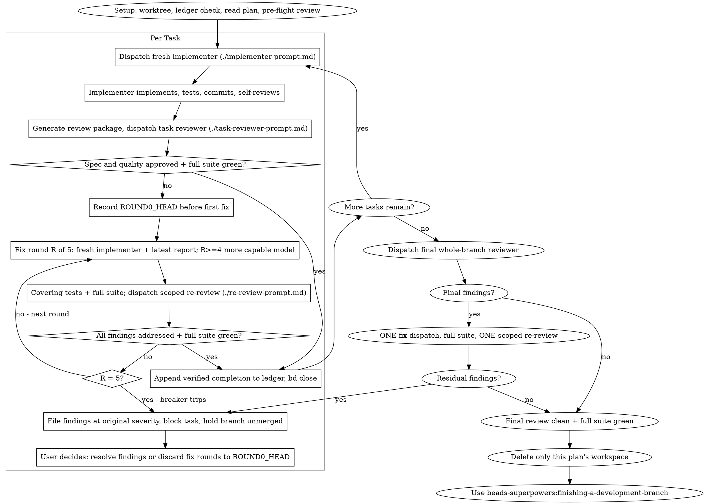

## The Process

At either review cap, follow [breaker-trip.md](breaker-trip.md). Security
findings block the epic and are never parkable. In a parallel batch, passing
siblings may finish normally; the tripped task stays unmerged and its
dependents stay blocked until the user decides its disposition.
